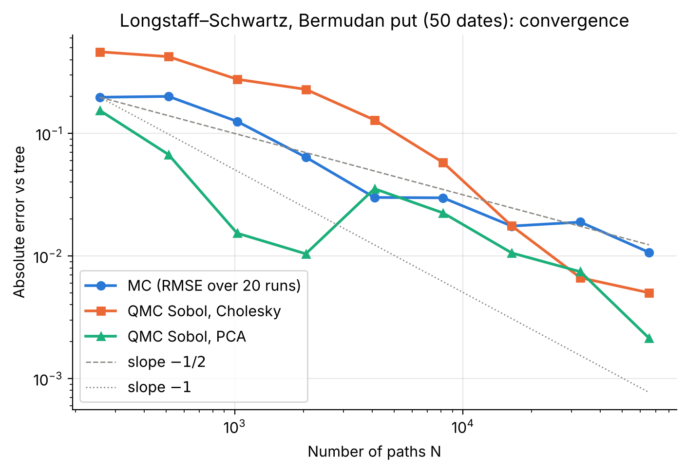
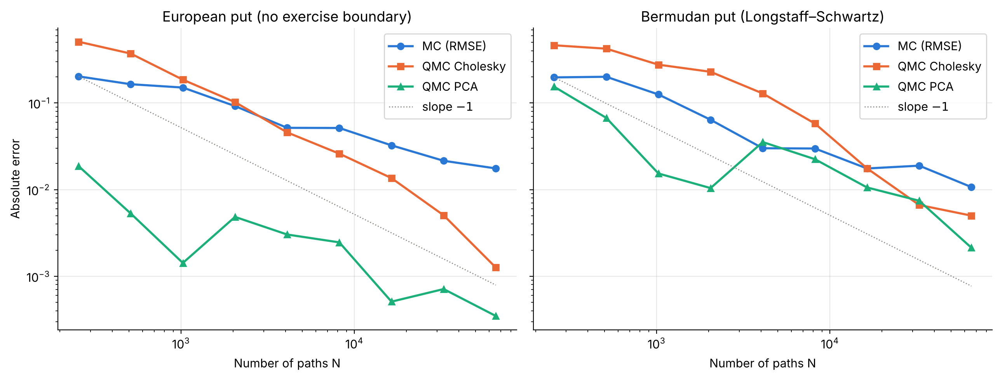

# Bermudan Option Pricing: Longstaff–Schwartz with Monte Carlo vs Quasi-Monte Carlo

Pricing a Bermudan put under Black–Scholes with the Longstaff–Schwartz algorithm, comparing pseudo-random (Monte Carlo) paths with Sobol (Quasi-Monte Carlo) paths built by two constructions of Brownian motion: Cholesky and PCA. Prices are validated against a Bermudan CRR binomial tree.

The full study is in [`bermudan_lsm_mc_vs_qmc.ipynb`](bermudan_lsm_mc_vs_qmc.ipynb).

## Key results

- With 2^16 paths, Sobol + PCA is about **5× more accurate** than Monte Carlo (error 0.002 vs an RMSE of 0.011).
- **The path construction matters more than the sequence.** With the same Sobol points, the Cholesky construction is worse than Monte Carlo up to 2^13 paths.
- The reason is **effective dimension**: the PCA puts 81% of the Brownian variance on the first Sobol coordinate, whatever the number of dates.
- **The exercise boundary limits the QMC gain.** On the European put computed from the same paths, the gain rises to about 50×: the discontinuity introduced by the exercise decision slows QMC down.
- The **regression bias** of Longstaff–Schwartz sets an error floor that QMC cannot break: the degree of the regression basis matters as much as the number of paths.





## Setting

| Parameter | Value |
| --- | --- |
| Spot S0 | 36 |
| Strike K | 40 |
| Rate r | 6% |
| Dividend yield q | 0 |
| Volatility σ | 20% |
| Maturity T | 1 year |
| Exercise dates d | 50 |

These are the benchmark parameters of Longstaff & Schwartz (2001). The reference price from the Bermudan tree is 4.4779.

## Contents of the notebook

1. Setting and parameters
2. Path simulation: Cholesky and PCA constructions, MC and QMC Gaussians, effective dimension
3. Reference prices: Black–Scholes, Bermudan CRR tree, Richardson extrapolation towards the American price
4. Longstaff–Schwartz: algorithm and sanity checks (Black–Scholes limit, Merton's theorem for calls)
5. Experiments: convergence, summary table, regression bias, European put on the same paths
6. Conclusion and limitations

## Running it

```bash
pip install -r requirements.txt
jupyter notebook bermudan_lsm_mc_vs_qmc.ipynb
```

The whole notebook runs in under a minute on a laptop.

## Acknowledgements

This project was developed with the help of Claude (Anthropic), used as a coding and writing assistant.

## References

- G. Pagès, *Numerical Probability: An Introduction with Applications to Finance*, Springer, 2018.
- F. Longstaff, E. Schwartz, *Valuing American Options by Simulation: A Simple Least-Squares Approach*, Review of Financial Studies, 2001.
- P. Glasserman, *Monte Carlo Methods in Financial Engineering*, Springer, 2003.
